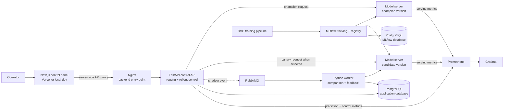
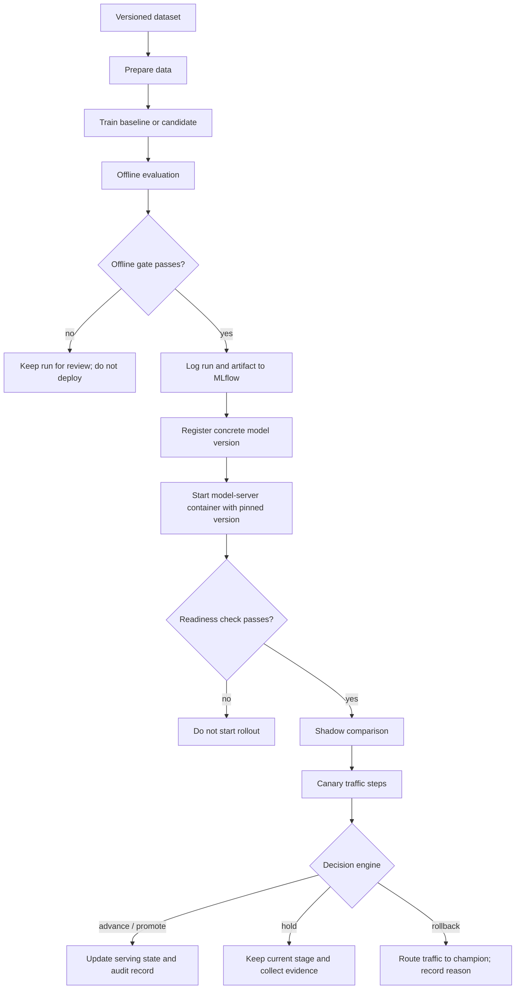
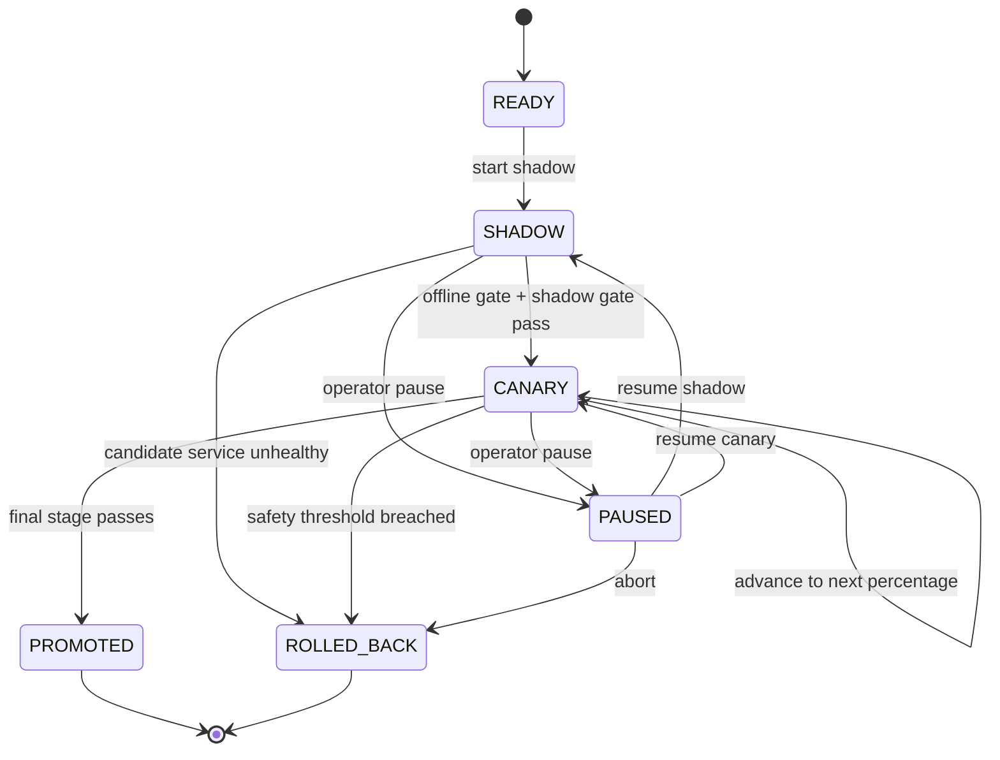

# Model Arena — Team Plan

> **Project status:** starter scaffold. This plan describes the intended MVP and the current repository state. The API and model server currently expose liveness checks; the rollout system, training stages, worker, prediction endpoint, and metrics are not implemented yet.

## 1. Project summary

**Model Arena** is a local-first MLOps application for safely testing and releasing machine learning model versions. It lets an operator register a candidate, compare it with the current champion in shadow mode, gradually send it prediction traffic, and promote or roll it back using explicit evidence.

The project demonstrates the lifecycle:

```text
version data → train and evaluate → register model → start candidate service
→ shadow compare → canary rollout → promote or rollback → inspect evidence
```

The MVP should prove that this workflow works for one small classification task. The value is the controlled release and its evidence, not a large model catalogue or a large number of services.

## 2. Goals and boundaries

### MVP goals

- Reproduce a small training and evaluation pipeline with DVC.
- Track runs and model versions in MLflow.
- Serve a champion and candidate model simultaneously.
- Compare a candidate in shadow mode without returning its prediction to the caller.
- Route a configurable share of prediction traffic to the candidate.
- Return a clear **advance/promote**, **hold**, or **rollback** decision with a reason.
- Show rollout controls and state in the Next.js UI.
- Record decisions and their metric evidence in an audit log.
- Observe service and model-version metrics in Prometheus and Grafana.
- Run the backend stack locally with Docker Compose and demonstrate both a successful release and a rollback.

### Keep out of the first release

- Kubernetes, multi-region deployment, autoscaling, or cloud-specific infrastructure.
- Multiple model families and a generic model marketplace.
- Automatic retraining from live feedback.
- A separate microservice for each route or policy rule.
- Claims about production performance or improved accuracy without collected evidence.

## 3. Recommended assignment model

Start with a small, reproducible scikit-learn classification problem, such as the built-in Wine dataset. Use a baseline and a candidate model, and report metrics such as macro-F1 and accuracy on the same held-out split.

For the live demo, use a request generator that submits examples as ordinary prediction requests and later sends their known labels as feedback. The label must not be included in the prediction request. This demonstrates delayed feedback while avoiding the false impression that accuracy is observable before a ground-truth label exists.

Prepare two deterministic scenarios:

1. A candidate passes offline checks and canary thresholds, then gets promoted.
2. A candidate breaches a deliberately configured health threshold and gets rolled back.

## 4. Architecture

### Runtime architecture



### Training and release flow



### Main service responsibilities

| Service | Owns | Does not own |
| --- | --- | --- |
| `frontend` | Operator-facing model, rollout, and audit UI | Model training or model routing decisions |
| `control-api` | Prediction routing, rollout controls, active rollout state, API validation | Long-running queue consumption |
| `model-serving` | Loading one concrete MLflow model version, prediction, readiness | Deciding which version gets traffic |
| `worker` | Shadow prediction, comparison, delayed-label processing, periodic policy evaluation | Public HTTP API |
| MLflow | Experiments, artifacts, registered versions, aliases and tags | Runtime canary percentage |
| DVC pipeline | Dataset references, pipeline inputs/outputs, reproducible stages | Serving model selection |
| PostgreSQL | Application state, prediction metadata, feedback, audit history | Time-series metrics |
| RabbitMQ | Durable asynchronous work events | Permanent audit history |
| Prometheus/Grafana | Metrics collection and visualization | Per-request history or audit records |

Keep the decision rules as a module in `control-api` for the MVP. The worker can call the same policy logic while processing comparison and feedback results. Avoid running independent copies of policy code.

## 5. Technology choices

| Area | Choice | Why it is here |
| --- | --- | --- |
| Frontend | Next.js App Router + TypeScript | Model Arena operator UI and server-side API proxy |
| JS package tooling | Bun workspaces | One JS workspace and one root `bun.lock` |
| JS lint/format | Biome | TypeScript linting and formatting |
| UI styling | Tailwind CSS; add shadcn/ui components as needed | Consistent dashboard/control layout |
| Backend HTTP | FastAPI + Uvicorn | Typed REST endpoints and ASGI serving |
| Reverse proxy | Nginx | Backend entry point; API route forwarding |
| Model code | Python + scikit-learn | Small, explainable baseline/candidate models |
| Python packaging | Per-service `pyproject.toml`; use `uv` to lock/sync each service | Separate Python dependencies by service |
| Pipeline | DVC | Versioned data references and reproducible stages |
| Tracking/registry | MLflow | Run metadata, model artifacts, model version registry |
| State | PostgreSQL + SQLAlchemy + Alembic | Rollout state, feedback, and audit records |
| Async processing | RabbitMQ + Python worker | Shadow comparisons and delayed feedback |
| Metrics | Prometheus Python client + Prometheus | Request, error, latency, and rollout metrics |
| Dashboards | Grafana | Versioned monitoring dashboard configuration |
| Local runtime | Docker + Docker Compose | Repeatable class demo with multiple containers |
| Frontend hosting | Vercel | Next.js frontend deployment |
| Secret scanning | GitGuardian `ggshield` | Local hook and GitHub Actions scan |

**FastAPI uses an ASGI server such as Uvicorn.** Waitress is a WSGI server and is not part of the selected FastAPI runtime.

## 6. Model and artifact ownership

Keep each tool’s responsibility distinct:

- **Git** tracks source, configuration, migrations, and small reports.
- **DVC** tracks dataset versions and pipeline dependencies/outputs. Store large data in its configured remote/cache, not directly in Git.
- **MLflow** stores training run details and registered model artifacts/versions.
- **PostgreSQL application database** records which concrete model versions are deployed and routed.

For inference, a model-server container must load a **concrete version URI**, such as `models:/wine-classifier/7`. It should not resolve `@latest` on every request. MLflow aliases such as `champion` and `candidate` are useful registry labels, but the active runtime routing state is held in the application database. That keeps the request path stable while an alias or UI label is being updated.

The local MLflow server uses a PostgreSQL metadata database and a persistent artifact volume. The application and MLflow databases share one local PostgreSQL server but are separate databases. The current SQL init file assumes the PostgreSQL user is `model_arena`, as in `.env.example`.

## 7. Request and event contracts

### Prediction request and response

The planned public request is versioned under `/api/v1`:

```json
{
  "request_id": "optional-client-id",
  "client_id": "demo-client-42",
  "features": {
    "feature_a": 1.25,
    "feature_b": 0.41
  }
}
```

The server generates a request ID if the caller omits one. The response should include the prediction, prediction ID, model version, and rollout stage so the UI and feedback generator can link the result to its serving version. Do not return internal secrets, database details, or unfiltered model artifacts.

### Canary routing

The control API reads the active rollout state and assigns requests to champion or candidate. For repeatable demonstrations, use deterministic bucketing based on `client_id` and rollout ID; if no client ID is supplied, use the generated request ID. The assignment must be recorded with the prediction.

Traffic stages are configurable. A demo sequence can be:

```text
100% champion → shadow → 5% candidate → 25% → 50% → 100% candidate
```

The exact percentage values and sample counts are demonstration policy, not universal operational thresholds.

### Queue event types

Start with versioned JSON messages and an `event_id` for idempotency:

- `shadow_comparison_requested`: prediction ID, candidate version, features or a safe input reference, and champion output.
- `feedback_received`: prediction ID, ground-truth label, and event time.
- `shadow_comparison_completed`: prediction ID, champion/candidate versions, outputs, and comparison result.
- `rollout_decision_recorded`: rollout ID, decision, evidence snapshot, and reason.

The worker should acknowledge a message only after its database write succeeds. Failed messages should be retried safely; duplicate events should not create duplicate feedback or audit records. RabbitMQ delivery is asynchronous and does not replace the durable application audit table.

For the class dataset, shadow events may contain synthetic features. For real or sensitive inputs, avoid copying raw data into the queue; use a protected reference and a retention policy.

## 8. Rollout state machine and decision rules



Decision outcomes:

- **Advance/promote:** configured service-health checks pass; enough observations exist; and, when labels are available, candidate quality meets the configured comparison rule.
- **Hold:** the minimum request count, minimum feedback count, or required metrics are missing; or the result is inconclusive.
- **Rollback:** candidate readiness fails, error rate/invalid output exceeds the configured limit, latency breaches the configured limit, or labeled model quality falls beyond the configured non-inferiority margin.

Keep policy values in a versioned configuration file. Record the policy version and the measured values in each decision audit row. Avoid presenting one metric as proof of another: unlabeled traffic can support health/latency decisions, but it cannot establish accuracy or F1.

## 9. Database design

The initial application schema should include:

| Table | Purpose |
| --- | --- |
| `model_deployments` | Concrete MLflow version, run ID, model signature, data/pipeline reference, offline metrics, readiness, and deployment status |
| `rollouts` | Champion and candidate versions, state, current stage/percentage, policy version, and timestamps |
| `predictions` | Prediction ID, selected model version, rollout ID, latency, result metadata, and status; avoid storing raw feature payloads by default |
| `feedback` | Prediction ID, ground-truth label, source, and received time |
| `model_comparisons` | Champion/candidate outputs or comparison summaries for shadow requests |
| `audit_events` | Actor, action, prior/new state, reason, evidence JSON, and event time |

Use Alembic migrations under `database/migrations/`. App repositories own query code; migrations own schema evolution. Treat `audit_events` as append-only at the application layer. A rollback is another audit event, not deletion of the failed candidate’s history.

## 10. API surface

Initial route proposal (all application routes versioned under `/api/v1`):

| Endpoint | Purpose |
| --- | --- |
| `POST /api/v1/predict` | Route and return a prediction |
| `POST /api/v1/feedback` | Attach delayed ground-truth label to prediction ID |
| `GET /api/v1/models` | List registered and serving model versions |
| `GET /api/v1/rollouts/active` | Read current rollout state and traffic share |
| `POST /api/v1/rollouts` | Start a shadow/canary rollout for a ready candidate |
| `POST /api/v1/rollouts/{id}/advance` | Request a manual stage advance when policy allows |
| `POST /api/v1/rollouts/{id}/pause` | Pause automatic advancement |
| `POST /api/v1/rollouts/{id}/abort` | Return traffic to champion and record rollback |
| `GET /api/v1/audit` | Read decision and operator-action history |
| `GET /health/live` | Process liveness check |
| `GET /metrics` | Prometheus metrics endpoint once instrumentation is implemented |

Manual controls should call the same state-transition service as automatic decisions. Do not implement a UI-only path that bypasses validation or audit logging.

## 11. Monitoring and observability

Prometheus metrics should use bounded labels such as `model_version`, `route`, `status`, `rollout_stage`, and a small controlled decision enum. Do not label metrics with request IDs, user IDs, raw feature values, or arbitrary exception strings; put request-level identifiers in logs and audit records instead.

Recommended metrics:

- `model_arena_requests_total{model_version,status}`
- `model_arena_request_duration_seconds{model_version}` histogram
- `model_arena_predictions_total{model_version}`
- `model_arena_invalid_predictions_total{model_version}`
- `model_arena_shadow_comparisons_total{result}`
- `model_arena_feedback_total{model_version}`
- `model_arena_rollout_decisions_total{decision,reason}`
- worker queue/processing metrics with bounded labels

Grafana dashboard panels:

1. Champion/candidate traffic share over time.
2. Request rate, errors, and invalid output by version.
3. Latency distribution by version.
4. Shadow match/disagreement rate.
5. Labeled quality comparison when enough labels exist.
6. Current rollout stage and recent decisions.

Provision dashboards and the Prometheus data source from `infra/grafana/`. The dashboard directory currently has a placeholder README; there is not yet a populated dashboard JSON file.

## 12. Frontend behavior

The Next.js frontend is the operator control panel; Grafana remains the detailed monitoring view.

Planned pages:

- **Overview:** active champion, candidate, rollout stage, canary percentage, health summary, and latest decision.
- **Models:** registered versions, evaluation results, run link, and readiness.
- **Rollouts:** start shadow, start/advance canary, pause, resume, and abort controls.
- **Audit:** chronological decisions with reason and metric evidence.

The current frontend is a static starter screen with an `/api/health` server-side proxy. It does not yet call model, rollout, or audit endpoints and displays no synthetic live metrics.

Keep the backend base URL server-side in `MODEL_ARENA_API_URL`. In Vercel, configure it to point to the deployed backend HTTPS origin. Do not use a localhost URL for a Vercel deployment. The browser should call Next.js server routes; those routes proxy to the backend so the backend origin stays out of browser configuration and CORS requirements stay narrow.

## 13. Docker, Compose, and deployment

### Local Compose services currently configured

Core profile:

- PostgreSQL (`5432`, bound to localhost).
- RabbitMQ management UI (`15672`, bound to localhost; AMQP `5672` is internal).
- MLflow (`5000`, bound to localhost) with PostgreSQL metadata and a persistent artifact volume.
- `control-api` liveness service.
- Nginx API proxy (`8080`, bound to localhost).

Optional `serving` profile:

- Two instances of the same model-server image: `model-champion` and `model-candidate`.

Optional `observability` profile:

- Prometheus (`9090`) and Grafana (`3001`), bound to localhost.

The worker is not yet declared in Compose. The model server currently exposes only liveness; it does not load a model or implement `/predict`. Prometheus configuration exists, but the applications do not yet expose their metrics endpoint.

### Image strategy

- Keep the control API and model server in separate multi-stage Dockerfiles.
- Build the model-server image once; set `MODEL_URI` per container to pin the champion/candidate version.
- Keep PostgreSQL, RabbitMQ, Nginx, Prometheus, and Grafana on their upstream images.
- Keep the frontend on Vercel and run `bun dev` locally. Add a frontend container only if a one-command fully containerized demo is needed.

### Deployment boundary

```text
Vercel: Next.js frontend
Docker-capable host: Nginx + control API + model servers + worker
Same backend host/Compose network: PostgreSQL + RabbitMQ + MLflow + Prometheus + Grafana
```

The Vercel frontend can only reach a backend that has a reachable HTTPS origin. Local Compose is the class development/demo setup; it does not itself establish a production deployment.

### Environment configuration

`.env.example` provides local placeholders for PostgreSQL, RabbitMQ, Grafana, and model URIs. Copy it to `.env`, replace the passwords, and never commit `.env`. The current database-init SQL assumes `POSTGRES_USER=model_arena`; update the SQL if you change the user. Avoid special characters in local passwords used inside database connection URIs unless they are URL-encoded.

## 14. CI/CD and GitGuardian

### Pull request checks to add

- Frontend: `bun install --frozen-lockfile`, Biome, TypeScript check, Next.js production build.
- Python services: `uv sync --locked`, Ruff, mypy, and pytest once behavior exists.
- Containers: build control API and model-server images.
- Secret scanning: GitGuardian workflow and local pre-commit hook.

### Release flow

1. A merged code change deploys the frontend through Vercel and builds/publishes backend images through GitHub Actions.
2. A candidate model artifact is registered in MLflow and its concrete version is selected for the candidate container.
3. The candidate starts and passes a readiness check.
4. An operator starts shadow/canary from the UI.
5. The controller advances, holds, promotes, or rolls back based on configured rules.
6. The final decision appears in the UI, Grafana, and application audit history.

Building a container or deploying the frontend is separate from promoting a model. The GitGuardian workflow requires the repository Actions secret `GITGUARDIAN_API_KEY`; `SECURITY.md` explains how to add it and install the local hook.

## 15. Repository map

```text
model-arena/
├── frontend/                     Next.js operator UI
├── backend/
│   ├── control_api/              FastAPI routing/control service
│   ├── model_serving/             One pinned model per container
│   ├── worker/                    RabbitMQ consumer (planned)
│   └── ml/                        DVC pipeline and training package
├── database/
│   ├── init/                      Local PostgreSQL bootstrap
│   ├── migrations/                Alembic migrations
│   └── seeds/                     Repeatable demo data
├── infra/
│   ├── mlflow/                    MLflow server image
│   ├── nginx/                     Backend reverse proxy config
│   ├── prometheus/                Scrape config
│   └── grafana/                   Datasource and dashboard provisioning
├── docs/                          Focused design/runbook documents
├── .github/workflows/             CI and GitGuardian workflows
├── compose.yaml                   Local multi-service stack
├── package.json + bun.lock        Frontend workspace and lockfile
└── PLAN.md                        Shared project plan (this document)
```

Python dependencies are declared per service in each `pyproject.toml`. Keep generated `uv.lock` files in Git once created. Bun and Python lockfiles should be committed; `.gitignore` excludes only local caches and generated artifacts.

## 16. Implementation milestones

| Milestone | Deliverable | Completion evidence |
| --- | --- | --- |
| 0. Foundation | Repo scaffold, GitGuardian, Compose dependencies, UI shell | Team can explain ownership and start local infrastructure |
| 1. Reproducible ML | DVC prepare/train/evaluate; MLflow runs and registered v1/v2 | Re-run pipeline and compare recorded metrics/model versions |
| 2. Serving | Model server loads exact URI; API routes champion predictions | Health/readiness and real prediction response include model version |
| 3. Persistence and audit | Migrations, rollout/prediction/feedback/audit tables | State survives restart; actions produce audit rows |
| 4. Shadow and feedback | Queue event contracts, worker, idempotent processing | Champion response returned; candidate comparison and delayed labels recorded |
| 5. Canary and decisions | Traffic buckets, state machine, promote/hold/rollback rules | Successful and forced-failure scenarios produce expected decisions |
| 6. Observability and UI | Prometheus metrics, Grafana panels, frontend control pages | UI, dashboard, and audit agree on release state and reason |
| 7. Assignment packaging | CI, Compose instructions, demo runbook, report/screenshots | A teammate can run the demo from documented steps |

Agree on the API and event contracts before splitting implementation. A practical team split is: ML pipeline/registry, backend and rollout policy, frontend controls, infrastructure/metrics, and one integration owner who reviews the shared contracts.

## 17. Definition of done for the MVP

- A clean local setup can reproduce two model versions and register them in MLflow.
- Champion and candidate containers load distinct, recorded model versions.
- Shadow mode never returns the candidate output to the caller.
- Canary traffic follows the configured percentage and records the version for every prediction.
- Insufficient evidence results in **hold**.
- A controlled safety breach results in an automatic rollback and a durable audit reason.
- A passing candidate can be promoted without rebuilding the API image.
- Grafana panels and frontend state are backed by real metrics/API data, not hard-coded demo values.
- The two demo scenarios are repeatable and documented.
- GitGuardian secret scanning is active in GitHub Actions and locally after account setup.

## 18. References

- [FastAPI deployment](https://fastapi.tiangolo.com/deployment/)
- [Waitress documentation](https://docs.pylonsproject.org/projects/waitress/en/latest/)
- [DVC pipeline guide](https://doc.dvc.org/user-guide/pipelines/defining-pipelines)
- [MLflow backend stores](https://mlflow.org/docs/latest/tracking/backend-stores/)
- [MLflow Model Registry](https://mlflow.org/docs/latest/ml/model-registry/workflow/)
- [Docker Compose](https://docs.docker.com/compose/)
- [Nginx load balancing](https://nginx.org/en/docs/http/load_balancing.html)
- [Prometheus instrumentation practices](https://prometheus.io/docs/practices/instrumentation/)
- [Grafana provisioning](https://grafana.com/docs/grafana/latest/administration/provisioning/)
- [Vercel monorepos](https://vercel.com/docs/monorepos)
- [GitGuardian `ggshield`](https://docs.gitguardian.com/ggshield-docs/getting-started)
