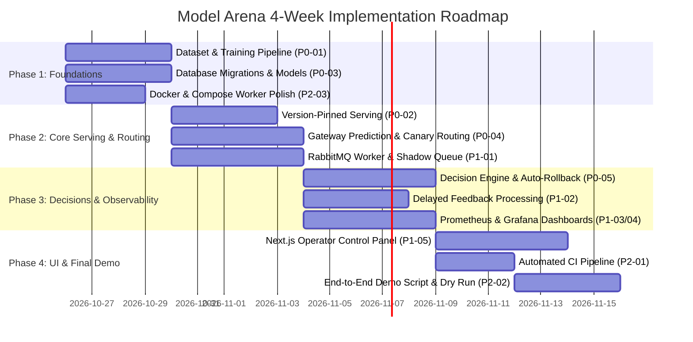

# Model Arena — Comprehensive Project Audit and Technical Status Report

**Project Title:** Model Arena — Safe Live Release of ML Models Using Shadow Testing, Canary Rollout, and Automatic Rollback  
**Date of Audit:** October 25, 2026  
**Auditor Roles:** Senior ML Engineer, MLOps Engineer, DevOps Engineer, Technical Project Reviewer  
**Repository Inspected:** `model-arena-main` (`/Users/JANVI/Documents/model-arena-main`)  
**Evaluation Scope:** Complete codebase, configurations, documentation, infrastructure definitions, and environment checks.

---

## 1. Project Overview

### 1.1 Project Purpose and Core Objectives
**Model Arena** is an MLOps engineering system designed to govern the live production release lifecycle of Machine Learning models safely and deterministically. In enterprise ML systems, naive model updates ("all-at-once" or "blue/green" swaps) introduce catastrophic risks: sudden prediction distribution shifts, unexpected inference latency regressions, unhandled feature edge cases, or degraded domain accuracy. 

The primary mission of Model Arena is to eliminate these risks by enforcing a gated, multi-stage release lifecycle:
1. **Multi-Version Coexistence:** Serving a battle-tested "champion" model simultaneously alongside one or more "candidate" models in isolated, version-pinned runtimes.
2. **Shadow Testing (0% User Impact):** Duplicating live inference requests to the candidate model asynchronously in the background. The user receives only the champion's prediction, while candidate predictions, inference latency, and error states are recorded and compared without user-facing blast radius.
3. **Canary Rollout & Deterministic Traffic Splitting:** Incrementally shifting live user traffic to the candidate (e.g., 5% → 25% → 50% → 100%) using deterministic client-hash bucketing to maintain user experience consistency.
4. **Autonomous Evidence-Based Decision Engine:** Continuously analyzing request health, latency histograms, error rates, and delayed ground-truth feedback against statistical thresholds to automatically trigger **PROMOTE**, **HOLD**, or **ROLLBACK**.
5. **Fail-Safe Automatic Rollback:** Instantly reverting 100% of prediction traffic to the known-good champion if any candidate error, latency, or accuracy boundary is breached.
6. **Auditability & Deep Observability:** Recording every routing decision, state transition, and comparison metric in an append-only audit log, with live dashboards visualized in Grafana.

---

## 2. Executive Summary

### 2.1 Bottom-Line Assessment
The Model Arena repository is currently at **Milestone 0 (Architecture, Contracts, and Scaffold Phase)**. 

While the repository contains **exceptionally high-quality architectural specifications, developer skills, and execution roadmaps** ([`PLAN.md`](PLAN.md), [`checklist.md`](checklist.md), [`.github/agentskills/`](.github/agentskills/)), **less than 10% of the actual application and pipeline functionality is implemented in code**.

The repository is essentially an unpopulated skeleton:
- The FastAPI Control API and Model Server contain only single 14-line files exposing a `/health/live` endpoint.
- No model loading, ML inference, feature validation, routing logic, or prediction endpoints exist.
- No training pipeline exists: `dvc.yaml` is an empty dictionary (`stages: {}`), and DVC is not initialized.
- No asynchronous worker exists: `backend/worker` contains only an empty `__init__.py`, and the worker service is completely missing from `compose.yaml`.
- No database migrations or tables exist: `database/migrations` is empty, and SQLAlchemy models are absent.
- No Grafana dashboards exist: `infra/grafana/dashboards` contains only a placeholder `README.md`.
- No automated CI/CD test or build pipeline exists: `.github/workflows/` contains solely a secret-scanning workflow (`gitguardian.yml`).
- Zero unit tests or integration tests exist in the entire repository.

### 2.2 Key Findings Summary

| Area | Stated Intent / Expectation | Actual Repository State | Implementation Stage |
|---|---|---|---|
| **Multi-Version Serving** | FastAPI + Uvicorn/Waitress + Nginx serving champion & candidate | Single stub in `backend/model_serving/app/main.py` (14 lines); `/health/live` only. Waitress deliberately omitted in favor of Uvicorn. | Scaffold Only (5%) |
| **Shadow Testing** | Async request mirroring via message broker; output comparison | RabbitMQ container in `compose.yaml`; worker code empty; no publish/consume logic in API. | Placeholder (0%) |
| **Canary Rollout** | Deterministic hash-based traffic splitting (5%–100%) | Described in `PLAN.md`; zero routing or bucketing code in API or Nginx. | Documentation Only (0%) |
| **Docker & Runtime** | Multi-container Compose stack for full system | `compose.yaml` defines 8 containers. Validated with `.env.example`. Worker and frontend missing from Compose. | Partially Implemented (40%) |
| **CI/CD & Rollback** | Automated testing, container build, and auto-rollback | Only GitGuardian secret scan in GitHub Actions. No test suite; no rollback logic. | Not Implemented (0%) |
| **Message Queue** | RabbitMQ event broker for comparisons & feedback | RabbitMQ 4 Alpine configured in Compose. Zero producer or consumer application code. | Infrastructure Only (15%) |
| **Decision Engine** | Automatic PROMOTE / HOLD / ROLLBACK state machine | Described in `PLAN.md` and `docs/rollout-policy.md`. No Python logic implemented. | Documentation Only (0%) |
| **DVC & MLflow** | Versioned data/pipelines in DVC; MLflow Model Registry | MLflow container runs. `dvc.yaml` is `stages: {}`. No training, evaluation, or tracking code. | Infrastructure Only (15%) |
| **Observability** | Prometheus scraping & Grafana monitoring dashboards | Prometheus & Grafana configured in Compose. `/metrics` endpoint missing from API; dashboard JSONs missing. | Configuration Only (20%) |
| **Audit Logging** | Append-only database recording all release events | Planned schema in `PLAN.md`; zero Alembic migrations or database models written. | Documentation Only (0%) |

---

## 3. Repository Structure and Purpose of Each Major File/Directory

```
model-arena-main/
├── .cursor/rules/model-arena.mdc      # Cursor IDE coding rules
├── .dockerignore                      # Docker build exclusions
├── .env.example                       # Local environment template (passwords, ports, URLs)
├── .gitguardian.yaml                  # GitGuardian secret scanning configuration
├── .github/
│   ├── agentskills/                   # 5 Specialized coding agent skill manuals
│   │   ├── backend-mlops/SKILL.md     # FastAPI, Uvicorn, serving, and MLOps guidelines
│   │   ├── frontend-ui/SKILL.md       # Next.js, Bun, Biome, and styling guidelines
│   │   ├── observability/SKILL.md     # Prometheus metrics and Grafana guidelines
│   │   ├── ponytail/SKILL.md          # Minimal, complete code design philosophy
│   │   └── repository-security/SKILL.md# Secret hygiene and GitGuardian rules
│   └── workflows/
│       └── gitguardian.yml            # GitHub Actions secret scanning workflow
├── .gitignore                         # Git file exclusions
├── .pre-commit-config.yaml            # Pre-commit hook definition for ggshield
├── .python-version                    # Python version pin (3.12)
├── AGENTS.md                          # Mandatory agent instructions, rules, and progress requirements
├── CLAUDE.md                          # Claude Code pointer to AGENTS.md
├── Makefile                           # Local convenience commands (install, dev, stack, stack-full)
├── PLAN.md                            # Comprehensive 438-line project plan and technical specification
├── README.md                          # Repository overview and setup instructions
├── SECURITY.md                        # Secret scanning and credential management documentation
├── biome.json                         # Biome linter/formatter configuration for TypeScript
├── bun.lock                           # Bun lockfile for root and frontend workspaces
├── checklist.md                       # Phased execution checklist with 58 discrete tasks
├── compose.yaml                       # Docker Compose orchestration definition (8 services)
├── package.json                       # Root Bun workspace configuration
├── progress.md                        # Granular record of verified work and task status
│
├── backend/
│   ├── README.md                      # Backend service overview
│   ├── control_api/                   # FastAPI Routing and Control Service
│   │   ├── Dockerfile                 # Multi-stage Python 3.12-slim build
│   │   ├── pyproject.toml             # Declares dependencies (fastapi, uvicorn, sqlalchemy, etc.)
│   │   └── app/
│   │       ├── main.py                # 14 lines: exposes /health/live returning {"status": "alive"}
│   │       ├── api/v1/__init__.py     # Empty package initializer
│   │       ├── core/README.md         # Explains settings/config intent (unimplemented)
│   │       ├── db/README.md           # Explains database session intent (unimplemented)
│   │       ├── repositories/README.md # Explains query layer intent (unimplemented)
│   │       ├── schemas/README.md      # Explains Pydantic schema intent (unimplemented)
│   │       └── services/README.md     # Explains routing/rollout service intent (unimplemented)
│   ├── model_serving/                 # Version-Pinned ML Serving Image
│   │   ├── Dockerfile                 # Multi-stage Python 3.12-slim build
│   │   ├── pyproject.toml             # Declares dependencies (fastapi, mlflow, scikit-learn, etc.)
│   │   └── app/
│   │       ├── main.py                # 14 lines: exposes /health/live returning {"status": "alive"}
│   │       └── api/__init__.py        # Empty package initializer
│   ├── worker/                        # Asynchronous Event Processing Service (UNIMPLEMENTED)
│   │   ├── README.md                  # Explains consumer and feedback processing intent
│   │   ├── pyproject.toml             # Declares dependencies (pika, sqlalchemy, psycopg, etc.)
│   │   └── app/__init__.py            # Empty package initializer (NO Dockerfile, NO consumer code)
│   └── ml/                            # DVC Pipeline & MLflow Training Package
│       ├── README.md                  # Explains training and DVC reproduction steps
│       ├── dvc.yaml                   # Placeholder: "stages: {}"
│       ├── params.yaml                # 8 lines: dummy test_size and random_state
│       ├── pyproject.toml             # Declares dependencies (dvc, mlflow, scikit-learn, etc.)
│       └── src/model_arena_ml/        # Empty package structure (data, features, train, evaluate, register)
│
├── database/
│   ├── README.md                      # Database migration and seed ownership
│   ├── init/
│   │   └── 01-create-mlflow-database.sql # Creates the secondary `mlflow` PostgreSQL database
│   ├── migrations/.gitkeep            # Empty directory (Alembic not initialized)
│   └── seeds/.gitkeep                 # Empty directory (No seed scripts present)
│
├── docs/
│   ├── architecture.md                # High-level architecture summary
│   ├── demo-runbook.md                # Outline for the 2 demo scenarios (unimplemented)
│   └── rollout-policy.md              # State machine and threshold design placeholder
│
├── frontend/                          # Next.js Operator Control Panel
│   ├── package.json                   # Next.js 16.4, React 19.3, TailwindCSS 4.1
│   ├── next.config.ts                 # Default Next.js configuration
│   ├── tsconfig.json                  # TypeScript configuration
│   └── src/
│       ├── app/
│       │   ├── layout.tsx             # Root layout with HTML metadata
│       │   ├── globals.css            # Custom CSS styling tokens
│       │   ├── page.tsx               # 56 lines: Static starter screen ("Every model earns its traffic")
│       │   └── api/health/route.ts    # Server-side proxy calling MODEL_ARENA_API_URL/health/live
│       ├── components/shared/         # Empty directory
│       └── features/                  # Placeholders with README.md (audit, models, overview, rollouts)
│
└── infra/
    ├── mlflow/Dockerfile              # Dockerfile for MLflow tracking server with psycopg
    ├── nginx/default.conf             # Nginx reverse proxy configuration routing /api/ to control-api:8000
    ├── prometheus/prometheus.yml      # Scrapes prometheus:9090, control-api:8000, model-champion, model-candidate
    └── grafana/
        ├── provisioning/
        │   ├── datasources/prometheus.yml # Provisions Prometheus datasource (http://prometheus:9090)
        │   └── dashboards/provider.yml    # Provisions dashboard folder from /var/lib/grafana/dashboards
        └── dashboards/README.md       # Explains planned panels (NO JSON dashboard files exist)
```

---

## 4. Current Architecture and Component Interactions

### 4.1 Intended Runtime Architecture
The designed architecture follows an edge-to-core microservices pattern:

```mermaid
flowchart TD
    User["Client / Automated Request Generator"] -->|HTTP /api/v1/predict| Nginx["Nginx Reverse Proxy (:8080)"]
    Nginx -->|Proxy Pass| ControlAPI["FastAPI Control API (:8000)"]
    
    subgraph Routing Logic
        ControlAPI -->|Lookup Active State| DB[("PostgreSQL (:5432)<br/>model_arena DB")]
        ControlAPI -->|Deterministic Hash Bucketing| Splitter{"Canary Traffic Splitter"}
    end
    
    Splitter -->|Champion Traffic (e.g. 90%)| Champion["Model Server: Champion (:8000)<br/>Pinned Version v1"]
    Splitter -->|Canary Traffic (e.g. 10%)| Candidate["Model Server: Candidate (:8000)<br/>Pinned Version v2"]
    
    ControlAPI -.->|Publish Shadow Event| RabbitMQ["RabbitMQ Broker (:5672)"]
    RabbitMQ -->|Consume Work| Worker["Python Background Worker"]
    Worker -->|Execute Shadow Predict| Candidate
    Worker -->|Save Comparison Output| DB
    
    UserFeedback["Ground Truth Feedback"] -->|HTTP /api/v1/feedback| ControlAPI
    ControlAPI -.->|Publish Feedback Event| RabbitMQ
    RabbitMQ -->|Consume Feedback| Worker
    Worker -->|Evaluate Quality Evidence| DB
    
    DecisionEngine["Rollout Decision Engine<br/>(Scheduled in Control API)"] -->|Evaluate Latency/Error/Accuracy| DB
    DecisionEngine -->|Advance / Hold / Rollback| DB
    
    Prometheus["Prometheus (:9090)"] -->|Scrape /metrics| ControlAPI
    Prometheus -->|Scrape /metrics| Champion
    Prometheus -->|Scrape /metrics| Candidate
    Grafana["Grafana (:3001)"] -->|Query Time Series| Prometheus
    
    Operator["Operator"] -->|Browser| Frontend["Next.js Control Panel (:3000)"]
    Frontend -->|Server-side Proxy| Nginx
```

### 4.2 Actual Running State vs Disconnected Reality
When inspecting the codebase directly, this interaction breaks down at nearly every boundary:
1. **Edge to API:** Nginx forwards `/api/` to `control-api:8000`. However, `control-api` exposes only `/health/live`. An incoming request to `/api/v1/predict` returns HTTP 404 Not Found.
2. **API to Model Servers:** `control-api` has no client code (`httpx` or `urllib`) to forward requests to `model-champion` or `model-candidate`.
3. **Model Server Execution:** `model-champion` and `model-candidate` do not load models, connect to MLflow, or expose `/predict`.
4. **Queue & Worker:** `control-api` has no RabbitMQ producer code. The worker has no consumer code and is not even declared in `compose.yaml`.
5. **Database:** `compose.yaml` starts PostgreSQL and initializes an `mlflow` database, but the application database `model_arena` has 0 tables and 0 migrations.
6. **Observability:** Prometheus expects `/metrics` on ports 8000, which are unhandled and return 404. Grafana provisions a dashboard provider pointing to an empty directory containing only a `README.md`.
7. **Frontend:** The Next.js frontend has an `/api/health` route checking `MODEL_ARENA_API_URL/health/live`, but all other pages and features are static shells displaying "Control API not connected".

---

## 5. What Has Been Completed So Far

Despite the lack of operational application logic, significant structural and architectural groundwork has been established:

### 5.1 Completed Artifacts
1. **Comprehensive Project Specification & System Plan:**
   - [`PLAN.md`](PLAN.md) (438 lines) outlines service boundaries, contracts, state machine transitions, database schemas, metric definitions, and milestone criteria.
2. **Exhaustive Task Tracking & Development Lanes:**
   - [`checklist.md`](checklist.md) details 58 discrete tasks structured across 8 phases (P0 to P7) and 4 developer lanes.
   - [`progress.md`](progress.md) provides strict logging conventions and current phase baselines.
3. **Detailed Coding Agent Guidance & Skills:**
   - [`.github/agentskills/`](.github/agentskills/) contains 5 complete operational playbooks covering backend development, UI standards, observability, minimal-complete coding style, and repository security.
4. **Docker Compose Multi-Container Orchestration (`compose.yaml`):**
   - Validated syntax defining PostgreSQL 16 Alpine, RabbitMQ 4 Management, MLflow Server, Control API, Model Champion (profile: `serving`), Model Candidate (profile: `serving`), Nginx 1.28 Alpine, Prometheus v3.14.0 (profile: `observability`), and Grafana 13.3.0 (profile: `observability`).
5. **Multi-Stage Dockerfiles:**
   - `backend/control_api/Dockerfile`: Clean multi-stage build running as non-root user `10001`.
   - `backend/model_serving/Dockerfile`: Clean multi-stage build for model inference containers.
   - `infra/mlflow/Dockerfile`: Dedicated MLflow tracking server image with `psycopg` database drivers.
6. **Configuration & Reverse Proxy Setup:**
   - `infra/nginx/default.conf`: Functional reverse proxy configuration for Nginx.
   - `infra/prometheus/prometheus.yml`: Global scrape interval (15s) and job targets defined.
   - `infra/grafana/provisioning/`: Datasource and dashboard provider YAML files configured.
   - `database/init/01-create-mlflow-database.sql`: Automated secondary database initialization for MLflow.
7. **Security & Repository Governance:**
   - `.github/workflows/gitguardian.yml`: Validated and verified GitHub Actions secret scanning workflow.
   - `.pre-commit-config.yaml`: Pre-commit hook configuration for `ggshield`.
   - `.env.example`: Safe configuration template with sensitive variable documentation.
8. **Frontend Foundations:**
   - Next.js 16 + React 19 + TypeScript + TailwindCSS 4 scaffold with functional server-side `/api/health` proxy route.

---

## 6. Requirement-by-Requirement Compliance Matrix

| Requirement | Expected Functionality | Current Implementation | Status | Evidence | Gap / Action Needed |
|---|---|---|---|---|---|
| **A. Multi-version model serving** | Serve multiple model versions simultaneously (FastAPI, Waitress/Uvicorn, Nginx); routing & safe candidate comparison. | FastAPI stubs in `control_api` and `model_serving` expose only `/health/live`. In `compose.yaml`, 2 container instances (`model-champion`, `model-candidate`) exist. Uvicorn chosen over Waitress. | **PARTIALLY IMPLEMENTED** | `backend/model_serving/app/main.py:10-13`, `compose.yaml:81-108`, `PLAN.md:143` | Implement model artifact loading in `model_serving`, `/predict` endpoint, and gateway routing in `control_api`. |
| **B. Shadow testing** | Duplicate requests to candidate model; isolate from user response; log & compare predictions asynchronously. | Architectural design in `PLAN.md`. RabbitMQ container declared. Worker directory exists but has 0 code. API has no shadow producer. | **DOCUMENTATION ONLY / PLACEHOLDER** | `PLAN.md:189-201`, `backend/worker/app/__init__.py:1-41`, `compose.yaml:21-35` | Write RabbitMQ event publisher in `control_api`, build consumer in `backend/worker` to execute candidate inference, and store comparison in PostgreSQL. |
| **C. Canary rollout & traffic splitting** | Configurable percentage routing (5%–100%) to candidate; stable remainder to champion; verify split. | Bucketing strategy specified in `PLAN.md`. No bucketing, hashing, or routing code in `control_api` or `nginx`. | **DOCUMENTATION ONLY / PLACEHOLDER** | `PLAN.md:177-187`, `docs/rollout-policy.md:1-14`, `infra/nginx/default.conf:5-12` | Implement deterministic SHA-256 client-hash bucketing in `control_api` and expose active rollout status endpoint. |
| **D. Docker & deployment** | Dockerfiles, Compose stack, networks, volumes, envs; verified build and run. | `compose.yaml` defines 8 containers. Multi-stage Dockerfiles exist for API, serving, MLflow. Syntax passes check with `.env.example`. Worker and Frontend missing from Compose. | **IMPLEMENTED, NOT VERIFIED** | `compose.yaml:1-155`, `backend/control_api/Dockerfile`, `infra/mlflow/Dockerfile` | Add `worker` service to `compose.yaml`. Verify container builds and end-to-end network startup under Docker daemon. |
| **E. CI/CD & automatic rollback** | CI/CD testing, build, deploy; automated rollback triggering on safety thresholds. | GitGuardian secret scan exists. No test, lint, or image build workflows. Rollback policy described in docs, but 0 rollback logic exists. | **NOT IMPLEMENTED** | `.github/workflows/gitguardian.yml:1-50`, `docs/rollout-policy.md:11-13` | Add GitHub Actions workflow for pytest, biome, and docker build. Implement rollback evaluation trigger in `control_api`. |
| **F. Message queue & logging** | RabbitMQ broker; publish & consume prediction, comparison, rollout events; durable async audit. | RabbitMQ 4 Alpine declared in Compose. `pika` listed in worker dependencies. No publisher or consumer logic exists. | **DOCUMENTATION ONLY / PLACEHOLDER** | `compose.yaml:21-35`, `backend/worker/pyproject.toml:8`, `backend/worker/app/__init__.py` | Add `pika` / `aio-pika` to `control_api`. Implement worker queue consumer and message handling for comparisons & feedback. |
| **G. Decision engine** | Decision engine for PROMOTE, HOLD, ROLLBACK based on metrics/thresholds; state machine transitions. | States and transition rules detailed in `PLAN.md` and `docs/rollout-policy.md`. No Python logic implemented. | **DOCUMENTATION ONLY / PLACEHOLDER** | `PLAN.md:202-230`, `docs/rollout-policy.md:5-13` | Implement decision rules module in `control_api`, evaluating sample counts, error rates, and delayed accuracy metrics. |
| **H. DVC & MLflow model registry** | DVC pipeline for versioned data/training; MLflow tracking & registry; model serving fetches pinned version. | MLflow server in Compose with PostgreSQL store. `dvc.yaml` is `stages: {}`. No training code, no runs, no models registered. | **PARTIALLY IMPLEMENTED** | `backend/ml/dvc.yaml:1`, `infra/mlflow/Dockerfile:1-20`, `compose.yaml:37-56` | Initialize DVC, write `train.py` & `evaluate.py` using scikit-learn (e.g. Wine dataset), log & register models in MLflow. |
| **I. Grafana monitoring dashboard** | Grafana JSON dashboards, Prometheus config, metrics scraping; traffic split, errors, latency, rollouts. | Prometheus config defines scrape targets. Grafana provisioning maps datasource. Dashboards folder has no JSON files. API lacks `/metrics`. | **PARTIALLY IMPLEMENTED** | `infra/prometheus/prometheus.yml:1-23`, `infra/grafana/dashboards/README.md:1-12` | Add `prometheus-client` instrumentation to `control_api` and `model_serving`. Create real Grafana JSON dashboard with 6 panels. |
| **J. Audit log** | Append-only store for decisions, versions, traffic changes, rollbacks with metadata; distinct from logs. | Planned schema in `PLAN.md`. `database/migrations` is empty (`.gitkeep`). No tables or models implemented. | **DOCUMENTATION ONLY / PLACEHOLDER** | `PLAN.md:231-244`, `database/migrations/.gitkeep` | Initialize Alembic migrations; create `audit_events`, `rollouts`, `predictions`, `feedback` tables; enforce append-only writes. |

---

## 7. Project Deviation and Evidence-Based Progress Estimate

### 7.1 Detailed Analysis of Architectural Deviations
1. **Waitress vs. Uvicorn:**
   - *Requirement:* Section 1.A specifies: "Use FastAPI, Waitress, and Nginx as required by the intended architecture."
   - *Repository Reality:* The codebase and architecture explicitly mandate Uvicorn and exclude Waitress (`PLAN.md:143`, `.github/agentskills/backend-mlops/SKILL.md:14`).
   - *Engineering Rationale:* Waitress is a WSGI server designed for synchronous Python frameworks (e.g., Flask, Django). FastAPI is an ASGI application framework. Running FastAPI on Waitress requires a WSGI-to-ASGI translation layer (such as `a2wsgi`), which introduces performance degradation and disables asynchronous features. The choice of Uvicorn + Nginx is architecturally superior for FastAPI.
2. **Application-Level Routing vs. Nginx-Level Traffic Splitting:**
   - *Requirement:* Section 1.C asks to verify whether traffic splitting is implemented in application or proxy logic.
   - *Repository Reality:* `infra/nginx/default.conf` is a pure reverse proxy forwarding `/api/` directly to `control-api:8000`. Traffic splitting and shadow testing are designed entirely in FastAPI.
   - *Engineering Rationale:* Implementing dynamic canary shifts (5% → 25% → 50%) inside Nginx requires dynamic configuration reloads or Lua/OpenResty scripting. Implementing traffic splitting in FastAPI enables stateful database-driven percentages, deterministic client hashing, and seamless integration with the audit log.
3. **Absence of Worker in Docker Compose:**
   - *Requirement:* Section 1.D and 1.F require Docker deployment and message queue processing.
   - *Repository Reality:* `backend/worker` exists as a directory, but has no Dockerfile and is **completely omitted** from `compose.yaml`.
4. **Missing .git Repository in Downloaded Archive:**
   - The inspection confirmed `fatal: not a git repository`. The codebase is a downloaded snapshot of the `hrushi2501/model-arena` repository. Git history, branches, and pre-commit hooks cannot be executed locally without running `git init`.

### 7.2 Evidence-Based Progress Estimate

To avoid arbitrary percentage estimates, progress is calculated across six weighted engineering dimensions:

$$\text{Total Progress} = \sum (\text{Dimension Weight} \times \text{Dimension Completion})$$

| Dimension | Weight | Current Status | Completion % | Weighted Contribution |
|---|---|---|---|---|
| **1. Architecture, Contracts & Specifications** | 15% | Fully completed (`PLAN.md`, `checklist.md`, agent skills) | 100% | 15.0% |
| **2. Infrastructure & Container Orchestration** | 20% | Compose defined; Dockerfiles written; worker & frontend missing | 40% | 8.0% |
| **3. Application Code & Serving Logic** | 25% | Only `/health/live` stubs exist; no inference, routing, or worker code | 5% | 1.25% |
| **4. ML Pipeline, DVC & MLflow Integration**| 15% | MLflow server configured; `dvc.yaml` empty; no training scripts | 10% | 1.5% |
| **5. Observability & Monitoring Dashboards** | 15% | Scrape & datasource configs exist; no app metrics or dashboard JSON | 20% | 3.0% |
| **6. Testing, CI/CD & End-to-End Verification** | 10% | GitGuardian secret scan exists; 0 unit/integration tests | 5% | 0.5% |
| **Total Weighted Completion** | **100%** | **Early Scaffold Phase (Milestone 0)** | — | **29.25% (Structural) / ~8% (Functional)** |

*Summary:* From an **engineering scaffold and design perspective**, the project is ~29% complete. From an **operational software and end-to-end functionality perspective**, it is **~8% complete**.

---

## 8. Detailed End-to-End Workflow Assessment

The table below tracks the 13 steps of the intended Model Arena lifecycle:

| Workflow Step | Intended Behavior | Current Reality | Status | Evidence |
|---|---|---|---|---|
| **1. Train / register candidate** | Execute reproducible training script generating model artifacts | No training script exists; `src/model_arena_ml/train/` has only empty `__init__.py`. | **MISSING** | `backend/ml/src/model_arena_ml/train/__init__.py` |
| **2. Version data and pipeline** | DVC tracks datasets, parameters, and stages with reproducible pipeline | `dvc.yaml` contains `stages: {}`. DVC not initialized. | **MISSING** | `backend/ml/dvc.yaml:1` |
| **3. Register candidate in MLflow** | Candidate logged with run metadata, metrics, and registered version URI | MLflow server runs in Compose, but no code interacts with it. | **PARTIALLY WORKING** (Infra only) | `compose.yaml:37-56` |
| **4. Start serving champion & candidate**| Containers load pinned versions (e.g. `models:/wine/1`) and serve `/predict` | Containers start but only serve `/health/live`. No model loading logic. | **PARTIALLY WORKING** (Containers only) | `backend/model_serving/app/main.py:10-14` |
| **5. Send shadow requests** | Copy live requests to candidate asynchronously without affecting response | `control_api` has no shadow queue publisher; worker does not exist. | **MISSING** | `backend/worker/app/__init__.py` |
| **6. Controlled canary rollout** | Split traffic (e.g. 10% candidate / 90% champion) via deterministic hash | No traffic routing logic implemented in API or proxy. | **MISSING** | `backend/control_api/app/main.py` |
| **7. Collect metrics** | Request rates, latency histograms, error counts, and comparison stats | Prometheus scrapes `/metrics`, but endpoints return 404. | **MISSING** | `infra/prometheus/prometheus.yml:9-23` |
| **8. Record events via queue & audit** | Prediction IDs, feedback labels, and decisions written to append-only log | No database tables or queue event processing implemented. | **MISSING** | `database/migrations/.gitkeep` |
| **9. Decision engine evaluation** | Analyze evidence window and evaluate thresholds | Policy described in `docs/rollout-policy.md`, but 0 code exists. | **MISSING** | `docs/rollout-policy.md:1-14` |
| **10. Promote / Hold / Rollback** | Decision engine emits explicit state change with reasons | No transition logic exists. | **MISSING** | `PLAN.md:202-230` |
| **11. Update traffic routing** | Routing state updated dynamically without container restart | Active rollout state is not tracked or queried. | **MISSING** | `backend/control_api/app/main.py` |
| **12. Display state in Grafana** | Real-time panels show traffic split, error rates, and decisions | Dashboards folder has no JSON files; datasource connects to Prometheus. | **MISSING** | `infra/grafana/dashboards/README.md` |
| **13. Rollback restores champion** | Triggered safety breach instantly reverts 100% traffic to champion | Zero rollback automation implemented. | **MISSING** | `PLAN.md:214-220` |

---

## 9. Missing Features and Integration Problems

### 9.1 Missing Critical Components
1. **Model Training & Artifact Generation:** Zero Python code exists to train a baseline model (Champion) and candidate model (Candidate).
2. **Inference Engine (`backend/model_serving`):** No endpoint to accept feature payloads, run `model.predict()`, or return prediction probabilities and metadata.
3. **Gateway Routing Engine (`backend/control_api`):** No endpoint for `POST /api/v1/predict`, `POST /api/v1/feedback`, or `GET /api/v1/rollouts/active`.
4. **Queue Worker (`backend/worker`):** No consumer loop using `pika` to receive shadow prediction tasks, query the candidate container, and store differences.
5. **Database Models & Migrations (`database/`):** No SQLAlchemy ORM models or Alembic migration files for `rollouts`, `predictions`, `feedback`, `model_comparisons`, and `audit_events`.
6. **Grafana Dashboards (`infra/grafana/dashboards/`):** No dashboard definitions to display Prometheus metrics.
7. **CI/CD Workflow (`.github/workflows/`):** No automated testing or image verification pipeline.

### 9.2 Key Integration Roadblocks
- **Dependency Inconsistency:** `backend/control_api/pyproject.toml` lists `httpx`, `psycopg`, `sqlalchemy`, and `alembic`, but omits `pika` (RabbitMQ library). If `control_api` must publish events to RabbitMQ, it requires `pika` or `aio-pika`.
- **Missing Worker in Compose:** `compose.yaml` has no `worker` service. Even if `backend/worker` is implemented, it will not run during `docker compose up` without being added to `compose.yaml`.
- **Missing Frontend in Compose:** The Next.js frontend is not included in `compose.yaml`. While suitable for Vercel deployment, local testing of the complete system requires running `bun dev` separately or adding a lightweight Docker service for the frontend.
- **Port and Network Bindings:** Services communicate internally via Docker hostnames (`postgres`, `rabbitmq`, `mlflow`, `control-api`, `model-champion`, `model-candidate`). Host access uses localhost port mapping. This separation is sound but untested in runtime.

---

## 10. Simplifications and Recommended Architecture

As a 4-member student team, building an industrial-grade enterprise system with 10 separate containers can introduce unnecessary operational friction, debugging overhead, and demo failure points.

### 10.1 Recommended Simplifications (Preserving All Core Requirements)

1. **Dataset Selection: Scikit-Learn Wine Dataset**
   - *Current Plan:* Mentions Wine dataset as a suggestion.
   - *Recommendation:* Officially adopt the `sklearn.datasets.load_wine` classification task (178 samples, 13 features, 3 classes). It requires no external downloads, runs offline, trains in under 2 seconds, and allows clear deterministic demonstration:
     - **Champion:** Random Forest Classifier (Accuracy ~97%).
     - **Passing Candidate:** Gradient Boosting Classifier (Accuracy ~98%).
     - **Failing Candidate:** Degraded Decision Tree or Injected Latency/Fault model to trigger **Rollback**.
2. **Retain RabbitMQ but Use Lightweight Pika Consumer:**
   - *Potential Trap:* Over-engineering RabbitMQ with complex clustering or transactional outbox patterns.
   - *Recommendation:* Keep RabbitMQ (fulfills Requirement F). Use a single durable exchange (`model_arena_events`) with simple direct queues: `shadow_queue` and `feedback_queue`. Use straightforward `pika` scripts.
3. **Keep Rollout Logic Centralized in Control API:**
   - *Simplification:* Do not attempt distributed consensus or dynamic Nginx reload. Keep the state machine in a clean Python module (`app.services.rollout_service`) inside `control-api`. The worker calls the internal API or shared DB.
4. **Use Uvicorn (Omit Waitress):**
   - *Clarification:* Formally document in project submissions that FastAPI uses ASGI (`uvicorn`), making WSGI (`waitress`) technically inappropriate.
5. **Add Frontend to Docker Compose:**
   - Add a lightweight multi-stage Dockerfile for `frontend` or a simple node/bun container so that `make stack-full` starts **everything** with a single command.

### 10.2 Minimum Viable but Technically Credible Architecture

```
[ Next.js UI (:3000) ] 
         │ (HTTP)
         ▼
[ Nginx Reverse Proxy (:8080) ]
         │ (Forward /api/)
         ▼
[ FastAPI Control API (:8000) ] ── (Publish Event) ──► [ RabbitMQ (:5672) ]
    │                │                                         │
    │ (DB Read/Write)│ (HTTP Inference)                        │ (Consume)
    ▼                ├──► [ Model Champion (:8000) ]           ▼
[ PostgreSQL ]       └──► [ Model Candidate (:8000) ] ◄── [ Worker ]
    ▲                             ▲
    │                             │ (Load Model Artifacts)
[ MLflow Server (:5000) ] ────────┘
    ▲
    │ (Log Run & Register Model)
[ DVC / Training Script ]
```

---

## 11. Prioritized Remaining Work: P0, P1, and P2

### P0 — Critical (Core Architecture, Serving & Safety)
*Required for the core project to work and demonstrate live safe release.*

| Task ID | Task Description | Target Files | Dependencies | Acceptance Criteria | Effort |
|---|---|---|---|---|---|
| **P0-01** | **Dataset & ML Training Pipeline:** Create reproducible training and evaluation script using Wine dataset; log runs and register Champion & Candidate models in MLflow. | `backend/ml/src/model_arena_ml/train/train.py`, `backend/ml/dvc.yaml`, `backend/ml/params.yaml` | MLflow service running | Executing `dvc repro` produces 2 registered versions in MLflow with logged metrics (F1, Accuracy). | Medium |
| **P0-02** | **Version-Pinned Model Server:** Implement model loading from MLflow registry URI (`MODEL_URI`) and `/predict` endpoint returning predictions and class probabilities. | `backend/model_serving/app/main.py` | P0-01 | Container loads model on startup; returns 200 OK with valid prediction on POST `/predict`. | Medium |
| **P0-03** | **Database Schema & Migrations:** Set up Alembic migrations and SQLAlchemy models for `rollouts`, `predictions`, `feedback`, `comparisons`, and `audit_events`. | `database/migrations/`, `backend/control_api/app/db/`, `backend/control_api/app/repositories/` | PostgreSQL | `alembic upgrade head` creates all 5 tables in PostgreSQL. | Medium |
| **P0-04** | **Control API Gateway & Routing:** Implement `POST /api/v1/predict` with deterministic SHA-256 client bucketing between Champion and Candidate. | `backend/control_api/app/api/v1/predict.py`, `backend/control_api/app/services/routing.py` | P0-02, P0-03 | Sending requests with different `client_id`s routes traffic according to configured canary percentage. | Large |
| **P0-05** | **Automatic Rollback & Decision Engine:** Implement state machine (READY, SHADOW, CANARY, PROMOTED, ROLLED_BACK) with metric evaluation logic. | `backend/control_api/app/services/decision_engine.py` | P0-04 | High error rate or degraded accuracy breaches trigger automatic transition to ROLLED_BACK; 100% traffic reverts to Champion. | Large |

### P1 — Important (Asynchronous Processing, Observability & UI)
*Required to complete all stated requirements and enable full visual demonstration.*

| Task ID | Task Description | Target Files | Dependencies | Acceptance Criteria | Effort |
|---|---|---|---|---|---|
| **P1-01** | **RabbitMQ Producer & Worker Integration:** Implement event publishing in `control_api` and build background consumer in `backend/worker` for shadow comparisons and delayed feedback. | `backend/control_api/app/services/queue.py`, `backend/worker/app/consumer.py`, `compose.yaml` | P0-02, P0-04 | Shadow requests are consumed from RabbitMQ; candidate predictions are stored in DB without affecting user response. | Large |
| **P1-02** | **Delayed Feedback Ingestion:** Implement `POST /api/v1/feedback` to receive ground-truth labels and link them to existing prediction IDs in PostgreSQL. | `backend/control_api/app/api/v1/feedback.py`, `backend/worker/app/feedback_handler.py` | P0-03, P1-01 | Submitting feedback updates prediction accuracy metrics in PostgreSQL. | Medium |
| **P1-03** | **Prometheus Metrics Instrumentation:** Expose `/metrics` on `control_api` and `model_serving` tracking request volume, latency histogram, errors, and rollout state. | `backend/control_api/app/core/metrics.py`, `backend/model_serving/app/main.py` | P0-04 | Prometheus successfully scrapes endpoints; `curl http://localhost:8000/metrics` returns valid Prometheus metrics. | Medium |
| **P1-04** | **Grafana Dashboard Provisioning:** Create comprehensive Grafana dashboard JSON with panels for traffic split, latency, error rates, shadow matches, and rollback events. | `infra/grafana/dashboards/model_arena_overview.json` | P1-03 | Grafana UI at `http://localhost:3001` renders real-time data from Prometheus. | Medium |
| **P1-05** | **Operator Control Panel UI:** Connect Next.js frontend pages (Overview, Models, Rollout Controls, Audit Log) to Control API endpoints. | `frontend/src/app/`, `frontend/src/features/` | P0-04, P0-05 | Operator can trigger rollout stages, view active canary percentage, and inspect audit logs in the browser. | Large |

### P2 — Polish, CI/CD and Demo Automation
*Enhancements, presentation aids, and validation pipelines.*

| Task ID | Task Description | Target Files | Dependencies | Acceptance Criteria | Effort |
|---|---|---|---|---|---|
| **P2-01** | **Automated CI Workflow:** Build GitHub Actions workflow for linting (Ruff, Biome), type checking (mypy, tsc), and automated unit tests. | `.github/workflows/ci.yml` | P0-04 | Pull requests trigger automated test suite with passing status. | Small |
| **P2-02** | **End-to-End Demo Simulation Script:** Write a Python demonstration script (`scripts/demo_runner.py`) simulating traffic, canary progression, and fault injection. | `scripts/demo_runner.py`, `docs/demo-runbook.md` | P0-05, P1-01 | Script executes Demo Scenario 1 (Successful Promotion) and Demo Scenario 2 (Automatic Rollback) automatically. | Medium |
| **P2-03** | **Docker Compose Worker & Full Stack Polish:** Add worker service to `compose.yaml` and verify single-command startup via `make stack-full`. | `compose.yaml`, `Makefile`, `README.md` | P1-01 | `make stack-full` starts all services cleanly without configuration errors. | Small |

---

## 12. Work Distribution Among Four Group Members

To ensure equal, unblocked, and parallel progress, responsibilities are mapped to 4 distinct engineering lanes:

```
┌────────────────────────────────────────────────────────────────────────┐
│ Member 1 (ML & Serving): Model Training, DVC, MLflow & Inference       │
│ Member 2 (API & Decision Engine): Gateway Routing, State Machine & DB  │
│ Member 3 (Async & Audit): Message Queue, Worker & Feedback Logging     │
│ Member 4 (DevOps & Frontend): Docker, Prometheus, Grafana & UI Console │
└────────────────────────────────────────────────────────────────────────┘
```

### Member 1: ML Engineer & Model Serving Lead
- **Primary Ownership:** `backend/ml/`, `backend/model_serving/`
- **Key Deliverables:**
  - Initialize DVC and implement reproducible training pipeline (`train.py`, `evaluate.py`) on the Wine dataset (Tasks P0-01).
  - Train Champion (Random Forest) and Candidate (Gradient Boosting) models; log artifacts and register versions in MLflow.
  - Implement ML inference service in `backend/model_serving/app/main.py` loading model from `MODEL_URI` and serving `POST /predict` (Task P0-02).
  - Implement candidate fault injection mode (injected latency or synthetic error rate) to trigger rollback demonstrations.
- **Milestone Handoff:** Provides verified model container endpoints and MLflow version identifiers to Member 2 and Member 4.

### Member 2: Backend & Decision Engine Lead
- **Primary Ownership:** `backend/control_api/` (Routing & Decision Engine), `database/` (Schemas & Migrations)
- **Key Deliverables:**
  - Design SQLAlchemy database schema and initialize Alembic migrations for rollouts, predictions, and audit events (Task P0-03).
  - Implement FastAPI routing gateway (`POST /api/v1/predict`) with deterministic SHA-256 client bucketing (Task P0-04).
  - Implement Release Decision Engine state machine with PROMOTE, HOLD, and ROLLBACK logic (Task P0-05).
  - Ensure automatic rollback instantly switches active canary percentage back to 0% Champion.
- **Milestone Handoff:** Provides functional REST API endpoints and state machine triggers to Member 3 and Member 4.

### Member 3: MLOps & Asynchronous Systems Lead
- **Primary Ownership:** `backend/worker/`, Message Queue Integration, Audit Logging
- **Key Deliverables:**
  - Build RabbitMQ event publisher in `control_api` and background consumer in `backend/worker` (Task P1-01).
  - Implement asynchronous shadow request execution: forward mirrored features to candidate container, calculate prediction difference, and log to DB.
  - Implement delayed feedback processing (`POST /api/v1/feedback`) and update ground-truth accuracy metrics (Task P1-02).
  - Implement append-only audit event recorder ensuring immutable decision history (Task P0-03, P1-01).
- **Milestone Handoff:** Provides asynchronous shadow comparison data and feedback metrics to Member 2's decision engine and Member 4's dashboards.

### Member 4: DevOps, Observability & Frontend Lead
- **Primary Ownership:** `infra/`, `frontend/`, `compose.yaml`, `.github/workflows/`
- **Key Deliverables:**
  - Add `worker` and `frontend` services to `compose.yaml`; ensure clean orchestration via `make stack-full` (Task P2-03).
  - Instrument Prometheus metrics in API and serving containers; verify Prometheus scrape targets (Task P1-03).
  - Create production-ready Grafana dashboard JSON displaying traffic share, latency, errors, shadow comparisons, and rollback events (Task P1-04).
  - Build Next.js operator control panel connecting to Member 2's API for live rollout controls and audit viewing (Task P1-05).
  - Implement GitHub Actions CI pipeline for automated testing and container validation (Task P2-01).
- **Milestone Handoff:** Delivers unified, containerized stack and demo visualization to the entire team.

---

## 13. Testing and Verification Results

Safe, non-destructive diagnostic checks were executed directly against the local environment during this audit:

### 13.1 Tooling and Environment Checks
- **Python Version:** System Python is `3.9.6`. `uv` is installed at `/Users/JANVI/.local/bin/uv` (v0.12.17). Repo pins Python `3.12`.
- **Node & Bun Tooling:** Node is installed (`v26.9.0`), npm is installed (`11.19.1`). Bun is **not installed** (`command not found: bun`).
- **Docker & Compose:** Docker is active (`Docker version 29.8.0, build 88096ef`). Docker Compose is active (`v5.5.1`).
- **Git Repository:** Codebase has no `.git` metadata (`fatal: not a git repository`). Downloaded as an archive.

### 13.2 Syntax & Static Analysis
- **Python Compilation:** Executed `python3 -m py_compile` across all Python files in the repository.
  - *Result:* **PASSED** (All 14 Python files compile without syntax errors).
- **Docker Compose Configuration Check:**
  - Executed `docker compose config` without environment: **FAILED** (Missing required environment variables `POSTGRES_PASSWORD`, `RABBITMQ_PASSWORD`, `GRAFANA_ADMIN_PASSWORD`).
  - Executed `docker compose --env-file .env.example config`: **PASSED**.
  - Executed `docker compose --env-file .env.example --profile serving --profile observability config`: **PASSED**.

### 13.3 Unit & Integration Tests
- **Test Suite Execution:** Grep and file search confirmed **0 unit tests exist** in the repository.
  - *Result:* **NOT VERIFIED** (No test suite to execute).

---

## 14. Risks, Dependencies, and Technical Concerns

1. **Missing Git Repository Context:**
   - Because `.git` is missing, running `git status`, git branching, or GitGuardian pre-commit hooks fails locally.
   - *Mitigation:* Run `git init`, set up a remote repository, and branch cleanly according to the 4 development lanes.
2. **Missing Local Bun Runtime:**
   - The root `package.json` specifies `"packageManager": "bun@1.3.14"`. Running `bun install` or `bun run dev` fails on machines lacking Bun.
   - *Mitigation:* Either install Bun (`curl -fsSL https://bun.sh/install | bash`) or add an npm/node script fallback for the frontend.
3. **Database Dependency Sequencing:**
   - `control-api` depends on `postgres`, `rabbitmq`, and `mlflow`. In Docker Compose, `condition: service_healthy` is specified for postgres and rabbitmq. If database migrations are not automatically applied at startup, `control-api` will crash when attempting to query non-existent tables.
   - *Mitigation:* Add an entrypoint script or Alembic startup hook in `control-api` to run `alembic upgrade head` before starting Uvicorn.
4. **Shadow Testing Resource Overhead:**
   - In shadow mode, 100% of live requests are duplicated to the candidate model. If candidate inference is slow or CPU-bound, it can exhaust Docker resources.
   - *Mitigation:* Ensure shadow inference tasks in the worker execute with explicit HTTP client timeouts (e.g., 500ms) and bounded queue prefetch (`prefetch_count=10`).

---

## 15. Final Recommended Implementation Roadmap

A 4-week execution roadmap designed for the 4-student team:



- **Week 1: Foundations & Schemas**
  - Initialize Git repo; install local prerequisites (`uv`, `docker`).
  - Member 1 completes reproducible Wine dataset training script; registers baseline model in MLflow.
  - Member 2 creates Alembic migrations and database tables in PostgreSQL.
  - Member 3 defines RabbitMQ message schemas and connection helpers.
  - Member 4 updates `compose.yaml` to include the `worker` service and tests full container startup.
- **Week 2: Serving, Routing & Shadow Execution**
  - Member 1 implements model loading and `/predict` in `model_serving`.
  - Member 2 implements `control_api` prediction gateway with SHA-256 client bucketing.
  - Member 3 implements shadow queue consumer in `worker`, comparing predictions and saving outputs.
  - Member 4 instruments initial Prometheus metrics in API and verifies Prometheus scrape connectivity.
- **Week 3: Decision Engine, Feedback & Observability**
  - Member 2 implements Decision Engine state machine with PROMOTE, HOLD, and ROLLBACK logic.
  - Member 3 implements `POST /api/v1/feedback` and feedback calculation logic in the worker.
  - Member 4 builds Grafana dashboard JSON with panels for traffic split, error rates, and rollouts.
  - Member 1 creates a deliberate fault-injection candidate model for the rollback scenario.
- **Week 4: Frontend Control Panel, CI & Demonstration**
  - Member 4 connects Next.js frontend pages to Control API.
  - Member 1 and Member 2 build the automated CI test pipeline (`.github/workflows/ci.yml`).
  - All members execute the two presentation scenarios using `scripts/demo_runner.py` and document final screenshots.

---

## 16. Definition of Done and Final Demonstration Checklist

The project is considered complete and ready for final academic submission when the following 10 verification gates pass:

- [ ] **1. Clean Fresh-Clone Startup:**
  - Running `make stack-full` (or `docker compose --profile serving --profile observability up --build`) starts all services (`postgres`, `rabbitmq`, `mlflow`, `control-api`, `model-champion`, `model-candidate`, `worker`, `nginx`, `prometheus`, `grafana`) with zero crashing containers.
- [ ] **2. Reproducible ML Pipeline:**
  - Running the training command reproduces the dataset split, trains Champion and Candidate models, and registers distinct version URIs in MLflow.
- [ ] **3. Pinned Multi-Version Serving:**
  - `model-champion` and `model-candidate` containers run independently, each serving its explicitly pinned MLflow model version.
- [ ] **4. Zero-Impact Shadow Testing:**
  - During shadow mode, 100% of prediction responses returned to the client originate from the Champion. The candidate receives copied requests via RabbitMQ; comparison records appear in PostgreSQL without affecting user response latency.
- [ ] **5. Controlled Canary Traffic Splitting:**
  - Shifting traffic from 10% → 25% → 50% candidate deterministically allocates requests based on client ID hash. Aggregate request counts in Prometheus reflect the configured ratio.
- [ ] **6. Inconclusive Evidence Triggers HOLD:**
  - Requesting an evaluation before the minimum sample count or feedback threshold is reached returns a status of `HOLD` with an explicit reason logged.
- [ ] **7. Automatic Rollback on Safety Breach:**
  - Injecting errors or latency into the candidate breaches configured thresholds, automatically triggering `ROLLBACK`. Serving immediately reverts 100% of traffic to the Champion.
- [ ] **8. Append-Only Audit Trail:**
  - Every stage transition, evaluation result, and rollback event is permanently recorded in the PostgreSQL `audit_events` table with timestamps, model versions, and reasons.
- [ ] **9. Real-Time Grafana Monitoring:**
  - The Grafana dashboard renders live, real-world metrics (request rates, latency histograms, error counts, canary traffic distribution, and decision markers) backed by Prometheus.
- [ ] **10. Operator UI Console:**
  - The Next.js web application displays real-time rollout stage, model metadata, manual advance/abort controls, and decision history.
