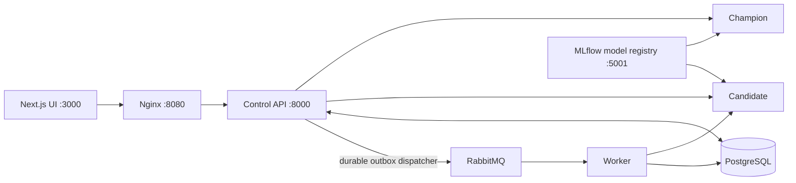

# Model Arena

A local release-testing application for a Wine classifier. Operators compare a
registered Candidate with the Champion, collect delayed labels, and advance or
roll back traffic using explicit evidence.



The API port is internal to Docker. Browser requests use the Next.js rewrite and
Nginx. PostgreSQL stores application evidence; MLflow uses its own persistent
tracking/artifact volume. Metrics are JSON API data shown in the operator UI.

## Start locally

Requires Docker Desktop, Bun, and Python 3.12 with uv. Python service images and
local training use committed uv lockfiles.

1. Copy `.env.example` to `.env`. Supply PostgreSQL and RabbitMQ passwords; keep
   `.env` out of Git. Passwords are read from environment variables.
2. Start infrastructure and register models:

   ```sh
   make infrastructure
   make train
   ```

   Training connects to `http://localhost:5001`, uses a reproducible stratified
   train/test split, logs held-out accuracy/F1, and registers both models. It writes
   their exact numbered identities to `backend/ml/models/versions.env` and the
   held-out inputs with true labels to `backend/ml/models/evaluation.json`.
   Registration failures stop training; no replacement model is trained by serving.
3. Start the API, serving containers, worker, and Nginx:

   ```sh
   make stack
   bun install
   bun run dev
   ```

   `make stack` reads `.env` and then the generated version file. Re-run it after
   training to recreate containers with the new identities. It never removes data
   volumes. `make stop` stops the containers while retaining stored data.
4. Open the operator UI at http://localhost:3000. MLflow is at
   http://localhost:5001 and RabbitMQ management is at http://localhost:15672.
   PostgreSQL is published on localhost:5433 for local administration.

The UI uses `MODEL_ARENA_API_URL` for its server-side gateway rewrite, defaulting
to `http://127.0.0.1:8080`. Set it in `frontend/.env.local` when changing the gateway.
An optional `NEXT_PUBLIC_MLFLOW_URL` controls the registry link.

## Release behavior

- **READY:** Champion serves requests. Both configured models must report matching
  identities before SHADOW or the initial canary probe can start.
- **SHADOW:** Champion serves all requests. Its prediction and shadow event commit
  together in PostgreSQL. A dispatcher retries publication until RabbitMQ confirms
  acceptance; the worker commits one comparison per prediction before acknowledging.
  Duplicate publication/delivery is safe. Agreement is separate from accuracy.
- **CANARY:** Requests are assigned deterministically using evaluation ID and client
  ID. The probe starts at 10%; subsequent steps are 25%, 50%, and 100%.
- **PROMOTED:** Candidate serves all traffic and remains monitored for safety.
- **ROLLED_BACK:** Champion serves all traffic. Start a new evaluation to retry.

The API automatically evaluates active stages every five seconds. Operator
`Evaluate now` and `Advance with evidence` use the same policy and row locks.
Each stage needs at least 20 Candidate requests. Error rate above 5% or Candidate
p95 above 200 ms causes rollback. Advancement additionally needs 20 genuine labels
for each model and Candidate accuracy no more than five percentage points below
Champion. Missing labels mean HOLD, never assumed 100% accuracy. Promotion retains
prior evaluation labels as the Champion reference while monitoring new live traffic.

Starting a new evaluation preserves old predictions, feedback, audit records, and
pending outbox tasks. Counts and decisions are scoped to the active evaluation,
configured model identities, and (for progression) the current stage. Inference
failures return HTTP errors with a null prediction and remain visible as failures.
The API rejects feedback for unsuccessful inferences.

## API

All application endpoints are available through `http://localhost:8080/api/v1`:

| Endpoint | Purpose |
|---|---|
| `POST /predict` | 13 finite Wine features and optional client ID; returns request ID, model identity, prediction, and latency |
| `POST /feedback` | Immutable first label: `prediction_id` and `ground_truth_label` (0, 1, or 2) |
| `GET /models` | Expected/loaded identities and readiness of both model servers |
| `GET /metrics` | Evaluation request counts, latency, error rate, and genuine labeled accuracies |
| `GET /shadow/summary` | Completed comparisons, agreement, and pending outbox tasks |
| `GET /predictions/recent` | Recent successful and failed requests in this evaluation |
| `GET /audit` | Historical release events |
| `GET /rollouts/active` | Current state and traffic split |
| `POST /rollouts/shadow` | Enter SHADOW from READY |
| `POST /rollouts/advance` | Start the 10% probe or advance one evidence-approved step; accepts `{}` |
| `POST /rollouts/evaluate` | Evaluate and apply the policy now |
| `POST /rollouts/rollback` | Restore Champion traffic; accepts a reason |
| `POST /rollouts/reset` | Start a new evaluation without deleting history |

Example:

```sh
curl http://localhost:8080/api/v1/predict -H 'Content-Type: application/json' \
  -d '{"client_id":"operator","features":[13.2,1.78,2.14,11.2,100,2.65,2.76,0.26,1.28,4.38,1.05,3.4,1050]}'
```

## Demonstrations

Run after training and starting the stack:

```sh
uv run --with httpx python scripts/demo_shadow_mode.py
uv run --with httpx python scripts/demo_gradual_rollout.py
```

Demos use exported held-out labels. The gradual demo reports the actual policy
outcome, which can be HOLD or rollback if the Candidate is worse. It does not
manufacture correct labels or guarantee promotion.

For the opt-in fault demo, set `ENABLE_DEMO_FAULTS=true` when starting/recreating
containers, then run `uv run --with httpx python scripts/demo_traffic.py`. Faults
apply only to naturally selected Candidate requests in CANARY. They cannot force
routing or affect SHADOW Champion responses. Disable the flag afterward.

## Verification

`make test` runs service tests and TypeScript checking. `bun run build` checks the
production frontend (`cd frontend && bun run build --webpack` is also supported).
Optional API integration tests require `TEST_DATABASE_URL`
and `TEST_RABBITMQ_URL` pointing to disposable services. They isolate PostgreSQL
schemas, but use fixed RabbitMQ queue names; do not use an application vhost.

Startup creates missing tables and idempotently upgrades the prediction column to
allow null for failed inference, preserving existing rows. Delivery requires the
PostgreSQL and RabbitMQ volumes to be retained. Failed worker tasks are parked in
`shadow_tasks.failed` and need replay after the cause is fixed. The application is
intended for a local operator environment; do not expose administration or demo
controls publicly without access controls.
